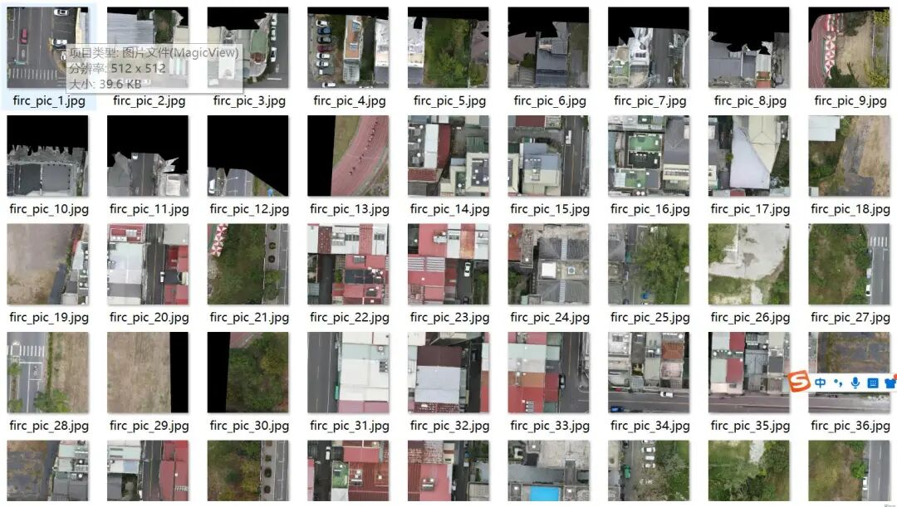
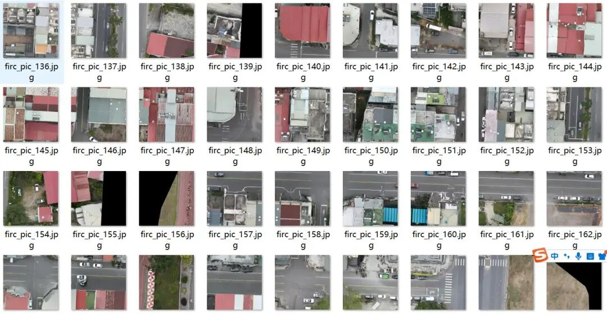
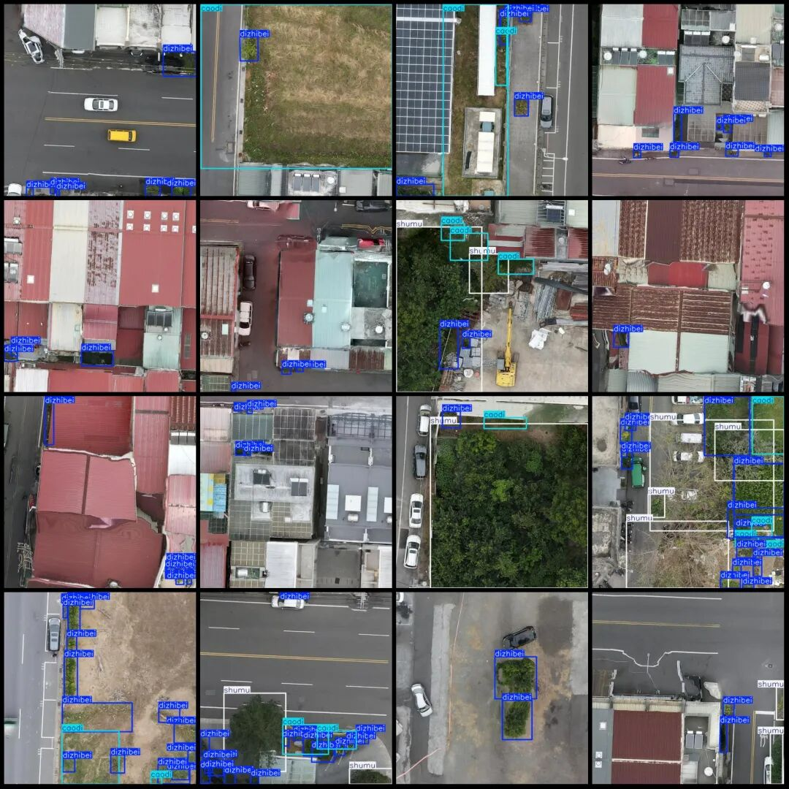
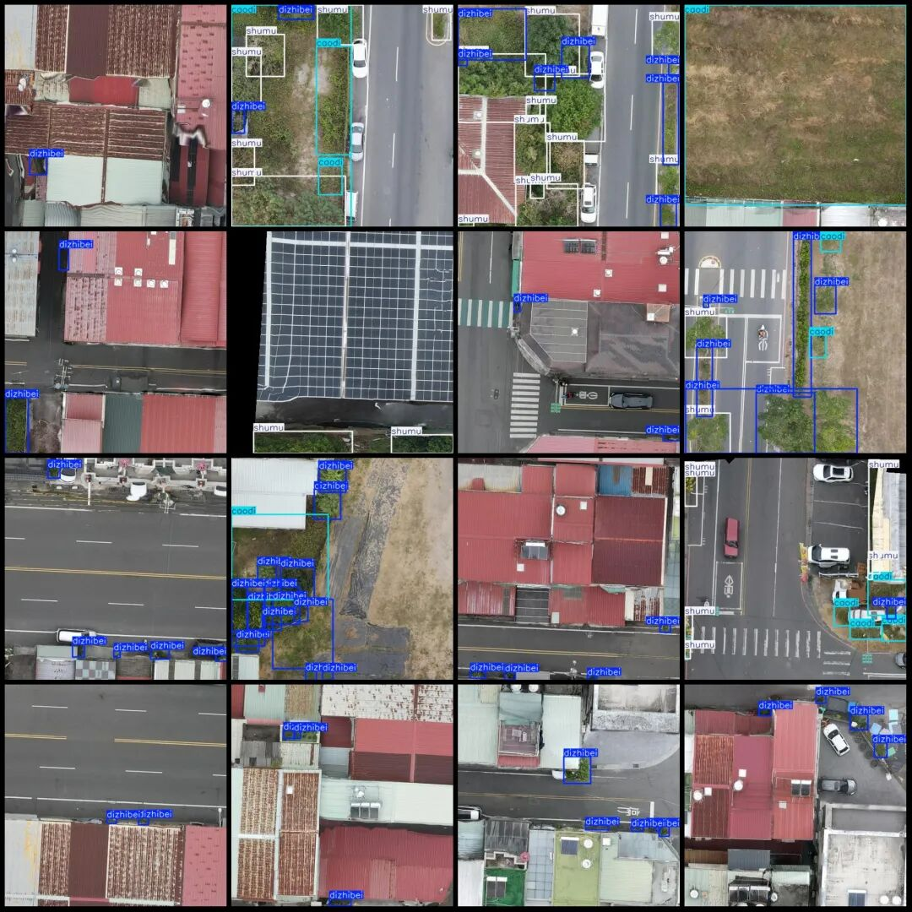

# UAV Perspective Smart City Greening Inspection Trees Grass Low Vegetation Detection Dataset VOC+YOLO format 208 images 3 categories

Dataset format: Pascal VOC format + YOLO format (txt file without split path, only containing jpg images and corresponding VOC format xml files and yolo format txt files)

Number of images (number of jpg files): 208

Number of annotations (number of xml files): 208

Number of annotations (number of txt files): 208

Label category count: 3

Label category names (Note that the order of categories in the YOLO format does not correspond to this, but is based on the labels folder's classes.txt): ["caodi", "dizhibei", "shumu"]

Number of boxes labeled in each category:

Caodi (grass) frame count = 151, occupying image count = 75

Dizhibei (low vegetation) frame count = 812, occupying picture count = 181.

shumu (tree) frame count = 292, occupying picture count = 88

Total frames: 1255

Image resolution: 512x512

Using labelImg:

Annotation rules: Draw a rectangle around the category.

Important Notice: The dataset does not have separate training, validation, and test sets; you need to partition them yourself.

Special : This dataset does not guarantee the accuracy of the trained models or weight files.

Drone: DJI MAVIC 3

Collection height: 20-30m

Sampling angle: 90°

Image Preview:

Annotation example:

## Payment

Here is a pay link on Stripe ( https://buy.stripe.com/3cs8yP7sY87d0vu9AB ). Please contact me lonlonago@foxmail.com after funding $89, and I will send you a complete data files , thank you!

